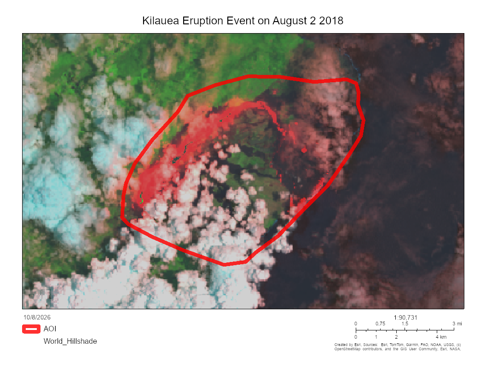
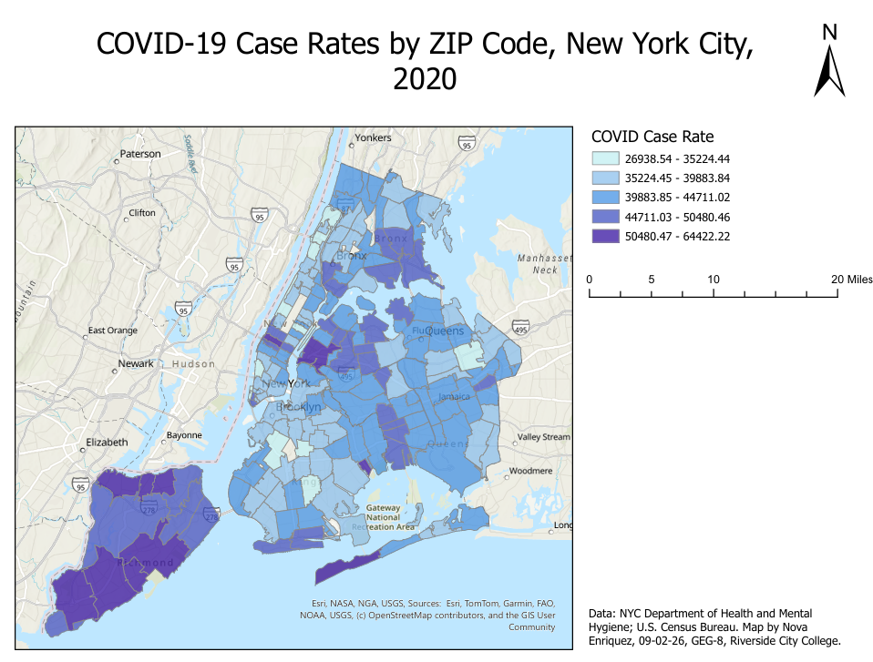

# Nova Enriquez

I'm a second year student at Riverside City College, studying Environmental Science. I'm studying Geographical Information Systems, or GIS, to learn more about how data in an area is classified and how different groups and different aspects form connections and relationships. 
---
## Kilauea Eruption Event 2018

*Interactive version, live as of September 2026: https://storymaps.arcgis.com/stories/0bd1cd9ff1424e498f4d28cbe07e22cd*

**Question:** What did Mount Kilauea look like after the first initial eruption, and how much area did it cover?

**Data:** LS 8 2 2018, spatial-admin_ucsb, 2024, ArcGIS Online

**Method:** For this map, I shifted the colors to ones that would appear most distinct to the human eye. I rearranged the red, blue, and green hues as well as the brightness and contrast of the image. I used the right side bar and edited these aspects in three sections: properties, styles, and effects. 

**A design choice I made and why:** Since this data is primarily imaging and does not show numerical data, there are no labels, and no legend. Its purpose is to display the area of the eruption. 

**A limitation of this map:** This map is unable to provide a direction; there is no compass providing north, south, east, or west on the map. 

---
## COVID Outbreaks in New York City 2020

**Question:** What areas of New York City had the highest rates of COVID-19 cases in 2020?

**Data:** COVID19_ZCTA, GGA_Admin, 2024, ArcGIS Online

**Method:** For this map, I imported the data and adjusted how it appeared to viewers. I navigated the symbology of the layer to change the data's appearance to what is shown here. I ensured that the different classes were separated by differing values in a single hue, and that the data followed the natural border of each ZIP code.

**A design choice I made and why:** I chose to use natural breaks because the data already classifies the information by ZIP code, so I found that matching the colored data to its rightful ZIP code made the map more cohesive and easy to comprehend.

**A limitation of this map:** This map is unable to provide the gender or age of the individuals within the data, only the rate numbers of COVID-19 cases and where they are located in New York City. The information given is very broad rather than very specific.

---
## Data sources
- LS 8 2 2018, spatial-admin_ucsb, 2024, https://www.arcgis.com/home/item.html?id=c250e0833c5541a5842fd31ba8d4ca47#overview
- COVID19_ZCTA, GGA_Admin, 2024, 
  
## Where this is going
By the end of this term, I plan to add a map I made that taught me something that holds the most significance and impact for myself, my education, and my academic journey. Since starting college and pursuing higher education, I have always made it a point to truly learn and educate myself on topics that I am unfamiliar with. I want my findings to speak on my character; I want to learn things that will help me understand the world a little bit more. Education has always held great importance in my life, and I want what I learn to reflect that. I want to prove to myself that I can overcome obstacles, that I can pick myself up and keep going, and that I am capable of intense focus and dedication; that is why I will succeed.
